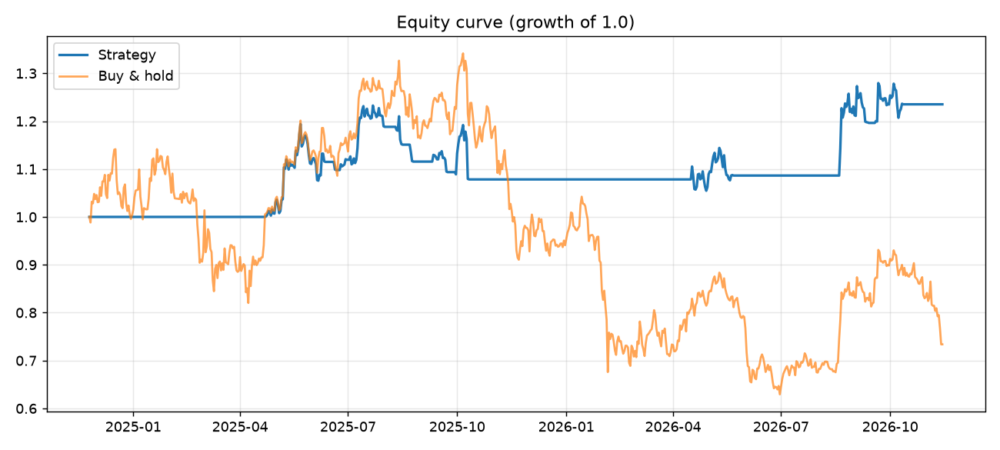

# quant-trader


Modular Python framework for researching and backtesting systematic crypto trading strategies.

> **Status:** research and paper trading only. No live capital.

## Features

- Vectorized backtester with transaction costs and next-bar execution (no look-ahead bias)
- Two strategies: time-series momentum with a trend filter, and z-score mean reversion
- Risk module: fixed-fractional position sizing, percentage / ATR / trailing stops, daily loss limit
- Market data and order routing via [ccxt](https://github.com/ccxt/ccxt), dry-run by default
- Settings and secrets loaded from environment variables
- Unit tests and CI on every push

## Quickstart

```bash
pip install -r requirements.txt
pytest
python -m scripts.run_backtest --strategy momentum --plot
```

## Results



Sample run: BTC/USD, daily bars, about two years of data. Regenerate with the command above.

Single asset, single period, no out-of-sample validation. Illustrative only.

## Project structure

```
quant/
  config.py          settings loader (.env)
  strategies/        base interface, momentum, mean reversion
  backtesting/       vectorized backtest engine
  risk/              position sizing, stops, loss limits
  execution/         ccxt exchange client (dry-run by default)
scripts/             command-line entry points
tests/               pytest suite
notebooks/           research notebooks
```

## Methodology

- Signals are shifted one bar, so trades execute on the following bar
- A 0.1% fee is charged on every position change
- Results are compared against a buy-and-hold benchmark
- Not yet modeled: slippage, funding rates, partial fills

## Roadmap

- [x] Multi-bar backtests with fees and benchmark comparison
- [x] Mean-reversion strategy
- [ ] Out-of-sample validation and walk-forward testing
- [ ] Paper-trading execution loop

## Disclaimer

Educational project. Not financial advice. Backtest results do not predict future performance.
